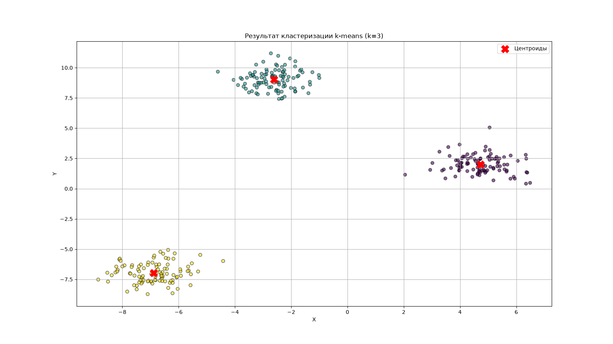
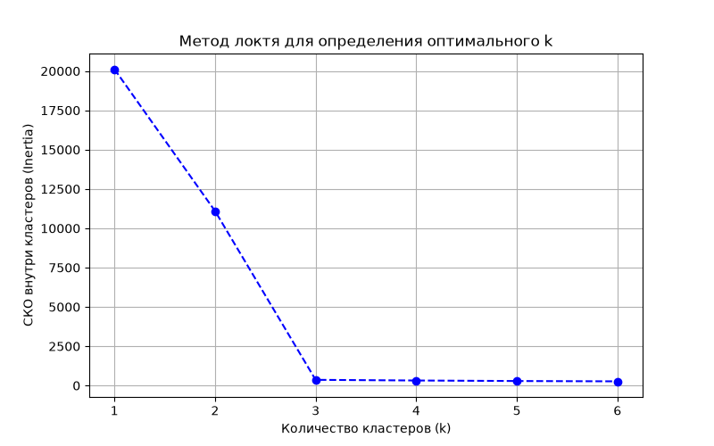

# Кластеризация методом k-means на Python

Лабораторная работа по теме **«Метод k-средних»** (трек Data Science)

* **Выполнила:** Сосновских Татьяна Андреевна
* **Группа:** 25КНТ-5

---

## Описание проекта
Программа реализует алгоритм машинного обучения **k-means без использования сторонних библиотек (``NumPy/Scikit-Learn``) в ядре вычислений**. Алгоритм разбивает данные на `k` групп по близости к центроидам. 

Библиотека ``NumPy`` применяется исключительно во внешнем CLI-интерфейсе для генерации демонстрационного Гауссова облака точек.

---

## Структура репозитория
```text
k-means-clustering/
├── .github/
│   └── workflows/
│       └── ci.yml             # Сценарий автоматического тестирования в GitHub Actions (CI/CD)
├── docs/                      # Папка с сгенерированными графиками
│   ├── clusters_plot.png      # Результат кластеризации k-means
│   └── elbow_plot.png         # График метода локтя
├── src/                       # Исходный код проекта
│   ├── __init__.py            # Инициализация пакета src
│   └── kmeans.py              # Реализация алгоритма KMeans, CLI и функций визуализации
├── tests/                     # Автоматические тесты
│   ├── __init__.py            # Инициализация пакета тестов
│   └── test_kmeans.py         # Модульные тесты (pytest) с проверками воспроизводимости и логики
├── .gitignore                 # Игнорируемые Git файлы и папки
├── pyproject.toml             # Манифест проекта и настройки линтеров (ruff, mypy, pytest)
├── uv.lock                    # Зафиксированные версии зависимостей
└── README.md                  # Документация проекта
```
---

## Установка и запуск

* **Интерпретатор:** Python версии `3.10` или выше (используются современные аннотации типов).
* **Инструменты:** Установленный глобально менеджер пакетов `uv` от Astral для быстрой и воспроизводимой сборки проекта.
* **Операционная система:** Поддерживаются Windows, macOS и Linux (пути к файлам генерируются кроссплатформенно через `pathlib`).

### 1. Синхронизация окружения
Разверните виртуальное окружение и установите зависимости одной командой из корня проекта:
```bash
uv sync --locked
```

### 2. Запуск кластеризации (CLI)
Сгенерируйте синтетический датасет, обучите модель и выведите метрики в консоль:
```bash
uv run src/kmeans.py --samples 300 --k 3 --iter 100 --seed 42
```
*Программа выведет распределение точек, финальное среднеквадратическое отклонение (СКО, Inertia) и сохранит график кластеров в `docs/clusters_plot.png`.*

### 3. Определение оптимального k (Метод локтя)
Запустите вычисление СКО для разных ``k`` и постройте график перегиба:
```bash
uv run src/kmeans.py --elbow
```
*График метода локтя будет сохранен в `docs/elbow_plot.png`.*

---

## Тестирование и качество кода

Проект полностью покрыт автотестами на фреймворке `pytest` и проверен статическими анализаторами.

### Запуск тестов
```bash
uv run pytest
```
*Тесты проверяют воспроизводимость по `seed`, монотонность убывания ошибки `inertia`, реакцию на изменение `k` и точность разделения.*

### Проверка линтерами и типизацией
```bash
uv run ruff check .
uv run mypy src tests
```
*Проверки проходят с **0 ошибок** в строгом режиме `mypy --strict`.*

---

## Результаты работы

### Кластеризация (k=3)


### Метод локтя

